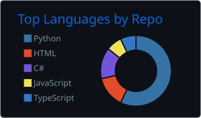
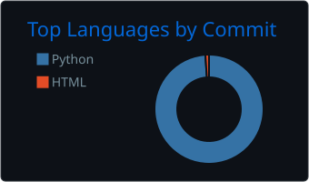
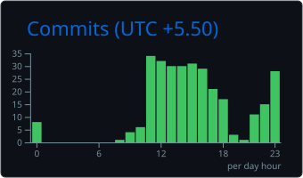
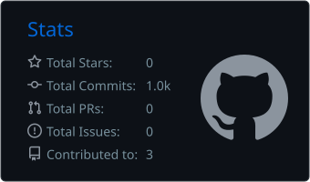
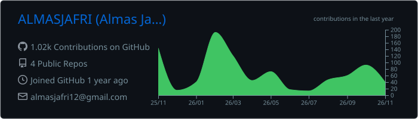

<!-- ============================== HEADER ============================== -->

 
  

 

<!-- ============================== ABOUT ============================== -->
<table align="center" width="100%">
<tr>
<td width="62%" valign="top">

### 👋 Professional Summary

Backend and Full-Stack Developer with **7 months of internship experience** building **.NET Core APIs**, **SQL Server stored procedures**, and **Python automation systems**, alongside **3+ production Django and AI applications**.

- 🔐 Enforcing **single sign-in** via **JWT token versioning**
- ⚡ Scaling authentication endpoints with in-memory **Bloom filters** (0.01% false positive rate)
- 🤖 Building multi-agent **LangGraph CLI tools** with **hybrid RAG retrieval**
- 🧮 Solved **190+ LeetCode problems**, showing strong data structures and algorithms proficiency

</td>
<td width="38%" valign="top">

### ⚡ Quick Facts

| | |
|:--|:--|
| 💼 **Role** | Backend Developer Intern |
| 🏢 **Company** | Brainpan Innovation |
| ⏳ **Experience** | 7 months (Apr 2026 – Present) |
| 📍 **Location** | Lucknow, UP, India |
| 🎓 **Education** | B.Tech CSE · BBDNIIT (AKTU) |
| 🗓 **Batch** | Aug 2024 – May 2028 |

</td>
</tr>
</table>

 

<!-- ============================== TECH STACK ============================== -->
<h2 align="center">🛠 Tech Stack</h2>

 

<b>Languages:</b> Python · C# (.NET Core) · SQL · JavaScript · HTML5 · CSS3

  

 

<table align="center" width="100%">
<tr>
<td width="25%" valign="top" align="center"><b>🧩 Backend & APIs</b> .NET Core Web API · Django · Django REST Framework (DRF) · RESTful APIs · Custom Middleware · JWT Token Versioning · Single Sign-In (SSO) · Bloom Filters · Magic Bytes File Validation · iTextSharp · BouncyCastle (DSC Signing) · Celery</td>
<td width="25%" valign="top" align="center"><b>🗄 Databases & Caching</b> Microsoft SQL Server (Stored Procedures, Joins) · PostgreSQL · SQLite · Django ORM · Redis Caching</td>
<td width="25%" valign="top" align="center"><b>🤖 AI, Agents & OCR</b> LangGraph · LangChain · Autonomous CLI Agents · Hybrid RAG · ChromaDB · Pinecone · BM25 · Reciprocal Rank Fusion (RRF) · Tree-sitter (AST) · NetworkX · Pydantic · RapidOCR · Playwright · ReportLab</td>
<td width="25%" valign="top" align="center"><b>🎯 Core Competencies</b> Authentication Systems · Digital PDF Signatures (DSC) · Dashboard Automation · Multithreading (ThreadPoolExecutor) · Payment Gateways (PayU, Stripe) · Data Structures & Algorithms (190+ LeetCode)</td>
</tr>
</table>

 

<!-- ============================== EXPERIENCE ============================== -->
<h2 align="center">💼 Work Experience</h2>

 

<table align="center" width="100%">
<tr>
<td width="50%" valign="top">

#### 🔐 Authentication & Logging APIs
Engineered authentication and logging APIs in **.NET Core**, enforcing single sign-in across active sessions via **JWT token versioning** assigned at user registration and verified through custom middleware on **100% of incoming requests**.

#### ⚡ Bloom Filter Optimization
Scaled the user login API by registering an in-memory **Bloom filter** on server startup to track unique emails with a **0.01% false positive tolerance**, filtering out **99.99%** of non-existent email lookups before hitting the database.

#### 🧱 SDA Saharanpur Admin APIs
Developed **10+ RESTful Admin APIs** in .NET Core for the **SDA Saharanpur portal** to manage dynamic homepage UI components, writing end-to-end **SQL Server stored procedures** and multi-table joins to reduce query execution overhead.

</td>
<td width="50%" valign="top">

#### 🛡 Binary File Validation
Implemented binary file validation for uploaded notice documents by inspecting the first **11 bytes (magic bytes)** of each file stream, blocking **100% of spoofed file extensions** prior to storage.

#### 🏛 Digital PDF Signature API
Constructed a digital PDF signature API using **iTextSharp** and **BouncyCastle** that consumes official **Digital Signature Certificate (DSC)** payloads from an upstream endpoint to cryptographically sign official government PDFs.

#### 🤖 Dashboard Reporting Automation
Automated dashboard reporting workflows using **Python** and **RapidOCR**, capturing live automation screenshots and generating structured Excel reports in a separate background thread to maintain zero main-thread blocking.

</td>
</tr>
</table>

 

 

<table align="center" width="100%">
<tr>
<td width="33%" valign="top">

#### 🏗 Full-Stack Applications
Architected **3+ full-stack web applications** using Django and Django REST Framework (DRF) featuring custom email and OTP authentication, role-based access control, and automated request validation.

</td>
<td width="34%" valign="top">

#### 🚀 Performance Optimization
Optimized database query performance and reduced API latency by implementing **Redis caching layers**, Django ORM query analysis, and concurrent data ingestion pipelines into **Pinecone** vector indexes.

</td>
<td width="33%" valign="top">

#### ☁️ Deployment
Deployed production applications across **Render, PythonAnywhere, and Railway** with Cloudinary CDN integration for optimized media delivery and SHA-512 cryptographic hashing for secure payment processing.

</td>
</tr>
</table>

 

<!-- ============================== PROJECTS ============================== -->
<h2 align="center">🧠 Projects</h2>

<table align="center" width="100%">
<tr>
<td width="100%" valign="top">

### 💻 Docmaker & Docmaker-CLI
**Autonomous CLI Agent & DaaS Platform** · 

- 🧠 Created an autonomous local CLI developer agent using **LangGraph** (boss orchestrator and specialist subagents) to generate **7 types of evidence-backed technical PDF reports** including security audits, API specifications, and module architectures.
- 🌳 Programmed a multi-language repository scanner and AST parser using **Tree-sitter** alongside a **NetworkX** symbol, call, and import graph with delta file detection to re-index 100% of modified files without full-repo crawls.
- 🔎 Configured a **hybrid RAG retrieval pipeline** combining semantic vector search (ChromaDB and Pinecone) with lexical search (BM25), merging results via **Reciprocal Rank Fusion (RRF)** for accurate code context retrieval.
- 🖥 Built **6+ custom agent tools** (symbol lookups, AST outlines, caller/callee traversal, grep search, and token-trimmed scratchpads) validated by strict **Pydantic** schemas inside an interactive **Textual TUI** with Playwright and ReportLab PDF rendering.

             

</td>
</tr>
</table>

<table align="center" width="100%">
<tr>
<td width="50%" valign="top">

### 🛒 Project Nexus AI
**AI-Powered E-Commerce Marketplace** · 

- Launched a full-stack e-commerce marketplace featuring custom email authentication, dynamic multi-variant product pricing, inventory tracking, and **Cloudinary CDN** asset management.
- Integrated the **PayU payment gateway** with SHA-512 transaction hashing and automated error recovery workflows to process customer checkouts securely.
- Formulated an automated codebase documentation pipeline using LangChain, ReportLab, Redis caching, and Python **ThreadPoolExecutor** multithreading to reduce PDF generation response times.

        

</td>
<td width="50%" valign="top">

### 💼 Business VEN
**Inventory & Financial Management System** · 

- Structured a normalized relational database schema with **composite indexing** and foreign key constraints to manage real-time stock tracking, order lifecycles, and financial dashboards.
- Accelerated page load speeds by integrating **Redis view caching**, custom Django context processors, and automated email notification triggers for order status updates.

      

</td>
</tr>
</table>

 

<!-- ============================== EDUCATION ============================== -->
<h2 align="center">🎓 Education</h2>

<table align="center" width="100%">
<tr>
<td align="center" width="50%">
<b>Bachelor of Technology (B.Tech) in Computer Science Engineering</b> 
BBDNIIT (Dr. A.P.J. Abdul Kalam Technical University), Lucknow, UP · Aug 2024 – May 2028
</td>
<td align="center" width="17%">
<b>Class 12 (ISC)</b> 
90%
</td>
<td align="center" width="17%">
<b>Class 10 (ICSE)</b> 
91%
</td>
<td align="center" width="16%">
<b>LeetCode</b> 
190+ solved
</td>
</tr>
</table>

 

<!-- ============================== CODING & ANALYTICS ============================== -->
<h2 align="center">📊 Codebase Breakdown & Coding Activity</h2>

<table align="center" width="100%">
<tr>
<td width="33%" valign="middle" align="center">
  
</td>
<td width="34%" valign="middle" align="center">
  
</td>
<td width="33%" valign="middle" align="center">
  
</td>
</tr>
</table>

<table align="center" width="100%">
<tr>
<td width="50%" valign="middle" align="center">
  
</td>
<td width="50%" valign="middle" align="center">
  
</td>
</tr>
<tr>
<td colspan="2" valign="middle" align="center">
  
</td>
</tr>
</table>

 

<!-- ============================== FOOTER ============================== -->

